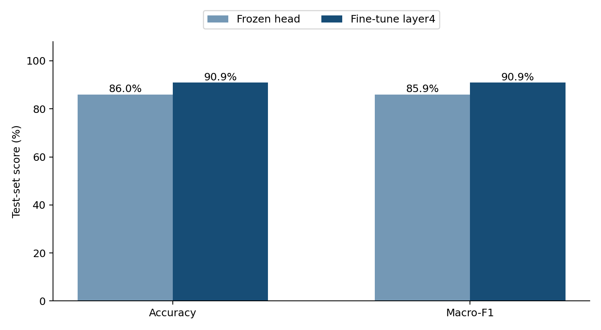

# CIFAR-3 Image Classification with ResNet18

I built this project as part of my machine learning capstone to see how much fine-tuning changes the performance of a pretrained image classifier on a small dataset. I used three classes from CIFAR-10 (cat, dog, and horse) and compared two ResNet18 training setups.

The main takeaway: fine-tuning the final residual block and classification head worked better on this test set than training the classification head alone. The comparison is not a controlled test of *only* freezing versus fine-tuning, since the learning rates also differ.

## Results

| Held-out test set (450 images) | Frozen backbone + trained head | Fine-tuned layer4 + head |
|---|---:|---:|
| Accuracy | 86.00% (387/450) | **90.89% (409/450)** |
| Macro F1 | 0.8590 | **0.9090** |
| Accuracy 95% bootstrap interval | 82.67–89.11% | 88.22–93.56% |

The difference was **4.89 percentage points** on these 450 matched test images. A paired bootstrap analysis estimated a 95% interval of 1.78–8.00 percentage points for that difference. These are results from one random seed on a limited subset—not an estimate of performance on every kind of animal image.



## What I did

- Selected 2,700 examples from the official CIFAR-10 dataset: **600 training, 150 validation, and 150 test images per class** (1,800/450/450 total).
- Used an ImageNet-pretrained ResNet18 with a new three-class output layer.
- Compared a frozen feature extractor with a setup that trains `layer4` and the final classification head.
- Trained both configurations for three epochs and selected checkpoints using validation macro-F1.
- Measured test accuracy, macro-F1, confusion matrices, and per-class performance.
- Compared the predictions on the same 450 test examples, including paired bootstrap and McNemar analyses.

The original 32×32 images were resized to 224×224 and normalized with ImageNet statistics. Random horizontal flips were used only for the training split.

## What I learned

Fine-tuning improved overall accuracy, but the gains were not equal across classes. Dog classification improved noticeably, while cat classification got slightly worse. Looking only at the overall accuracy would have hidden that difference. I also learned to keep the test set separate from checkpoint selection and to compare predictions image by image when testing two models on the same examples.

There are clear limits to this experiment: the data is small, I ran one seed, and I changed both the trainable layers and learning rate. A next step would be to run multiple seeds and tune one variable at a time.

## Run it locally

Python 3.10+ is recommended. Install a compatible PyTorch/Torchvision pair for your platform first, then the remaining dependencies:

```bash
python3 -m venv .venv
source .venv/bin/activate
python -m pip install torch torchvision
python -m pip install -r requirements.txt
```

To train and evaluate from the source dataset (CIFAR-10 is downloaded by Torchvision):

```bash
python capstone.py prepare --download
python capstone.py train --mode frozen --epochs 3
python capstone.py train --mode fine_tune --epochs 3
python capstone.py evaluate --mode frozen
python capstone.py evaluate --mode fine_tune
python analyze_results.py --results runs
```

The project uses seed 42 and the saved split file records exactly which original CIFAR-10 images were used. The original run used macOS / Apple MPS; results may vary with the hardware and package versions. PyTorch pretrained weights need to be available online or supplied with `--weights-file` during training.

To re-check the archived prediction comparison **without retraining**, run:

```bash
python analyze_results.py --results runs
python -m unittest discover -s tests -v
```

## Files

| Path | Description |
|---|---|
| `capstone.py` | Data preparation, training, and model evaluation |
| `analyze_results.py` | Paired prediction comparison and statistical analysis |
| `make_report.py` | Generates the detailed PDF report |
| `capstone_report.pdf` | Detailed methods, figures, and results (14 pages) |
| `runs/` | Saved split manifest, metrics, prediction CSVs, and plots |
| `tests/` | Checks for split integrity, reproducibility, and saved predictions |

The repository intentionally does **not** include the raw CIFAR-10 images or large model checkpoint files. Retraining is needed to reproduce the checkpoints themselves; the included prediction files support verification of the published comparison.

## References

- [CIFAR-10 dataset](https://www.cs.toronto.edu/~kriz/cifar.html) — Krizhevsky (2009)
- [Deep Residual Learning for Image Recognition](https://arxiv.org/abs/1512.03385) — He et al. (2016)
- [PyTorch transfer learning tutorial](https://docs.pytorch.org/tutorials/beginner/transfer_learning_tutorial.html)

*Course context: developed for a Udacity machine learning capstone. The code, analysis, and results presented here are for this project; the dataset and pretrained architecture are credited above.*
